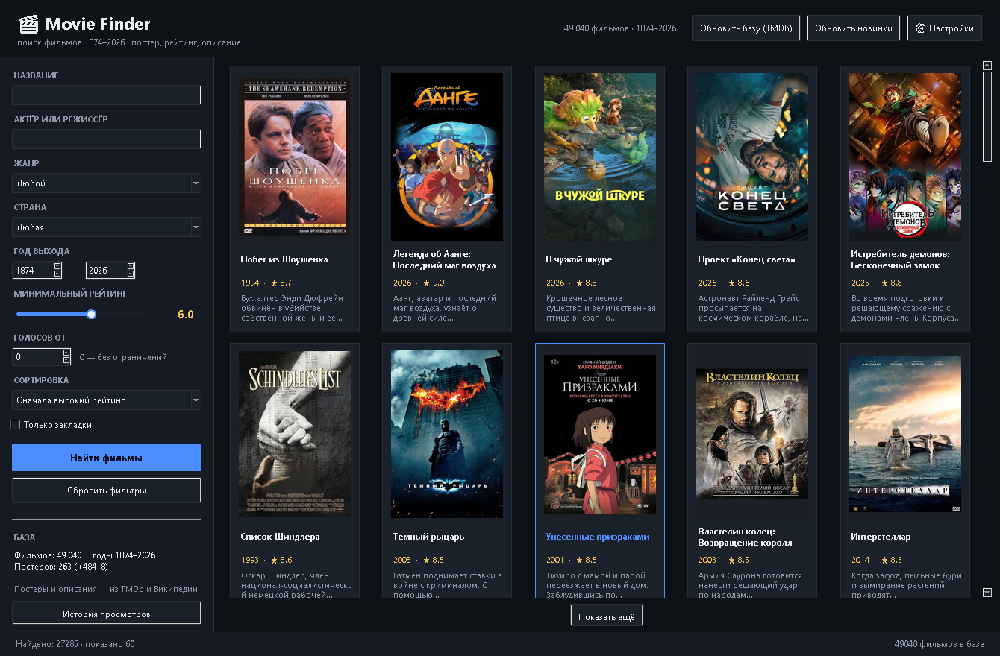
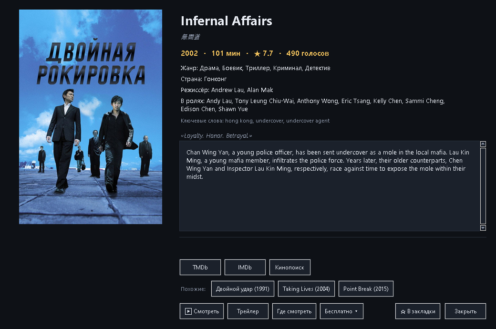

# 🎬 Movie Finder — поиск фильмов 1874–2026

Настольное приложение (Python + Tkinter) для подбора фильма на вечер: фильтры по **рейтингу, жанру, году и стране**, а в результатах — **постер и описание**.



Окно фильма — крупный постер, полное описание и ссылка на источник:



## Возможности

- **Фильтры:** название (по подстроке и с ограниченным поиском по опечаткам в
  русских/оригинальных названиях), жанр, настроение/тема, страна,
  диапазон лет 1874–2026, минимальный рейтинг, минимальное число голосов, сортировка.
- **Подборки:** независимые фильтры жанра, настроения и темы можно сочетать;
  пользовательские наборы фильтров сохраняются в локальной базе.
- **Персональный подбор:** рекомендации учитывают оценки, жанры, ключевые слова,
  актёров, длительность и отзывы «подходит / не моё»; карточка объясняет
  совпавшие признаки. Отзывы можно просматривать и сбрасывать.
- **Список «Хочу посмотреть»:** отдельный список с приоритетом и заметкой;
  добавить фильм можно из карточки, а список редактировать отдельно.
- **Проверка качества каталога:** read-only отчёт о дубликатах, подозрительных
  годах и пустых/коротких описаниях с источником данных и переходом к фильму.
- **Режим просмотра подборки:** поочерёдно показывает фильмы из текущих фильтров,
  исключает просмотренное и позволяет отметить просмотр, поставить оценку или пропустить.
- **Фильм на вечер:** отдельный случайный выбор по жанру, настроению, теме и пределу
  длительности; просмотренное исключается. При заданном лимите фильмы без известной
  длительности не предлагаются. Результат можно открыть в деталях или выбрать заново.
- **Карточки:** просмотренное и личную оценку можно менять прямо в выдаче; окно фильма
  синхронизируется с карточкой.
- **Статистика вкусов:** оценки, просмотренные фильмы, любимые жанры, годы и активность.
- **Новые режимы и подборки:** слепой выбор скрывает название и постер до явного открытия;
  челленджи считают уникальные жанры, страны и десятилетия среди просмотренного;
  локальная фильмография объединяет актёрские и режиссёрские записи со статусами;
  франшизы предлагают только следующий подтверждённый и доступный в каталоге фильм;
  «двойник» объясняет общие признаки и подтверждённые различия; годовой отчёт использует
  даты истории просмотров; «Мне всё равно» предлагает несколько разнообразных вариантов,
  исключая просмотренное, оценённое, нежелательное и слишком длинное.
- Эти режимы используют каталог и личные данные на устройстве. Фильмография, челленджи,
  двойники, годовые отчёты и «Мне всё равно» не обращаются к сети; порядок франшизы
  использует уже существующий запрос подтверждённой коллекции TMDb только по команде.
- **Личные данные:** версионированный JSON экспортирует и импортирует только
  просмотренное, личные оценки, закладки, список «Хочу посмотреть», отзывы и
  сохранённые фильтры. Импорт проверяется до атомарной записи, неизвестные ID
  показываются пользователю; каталог и постеры не меняются.
  Экспортируйте файл регулярно и храните его отдельно: каталог и API-ключ в него не входят.
- **Выдача:** сетка карточек с постером, названием, годом, рейтингом и коротким
  описанием; клик по карточке открывает окно с крупным постером и полным описанием
  (жанр, страна, режиссёр, длительность, актёры, доступные площадки из имеющегося кэша,
  ссылки на источники).
- **Локальная база SQLite** — работает без интернета, поиск мгновенный.
- **Обновление базы из TMDb** по бесплатному API-ключу: тысячи фильмов, русские
  описания, страны, режиссёры, постеры.
- Постеры кэшируются на диск, интерфейс не подвисает: сетевые запросы идут в
  фоновых потоках.
- **Справочник:** актёры (347 088 записей), ключевые слова (156 598), «похожие
  фильмы» по общим ключевым словам и жанрам, закладки и история просмотров.

## Быстрый запуск

### Вариант 1 — готовый exe (Python не нужен)

Откройте `dist/Movie Finder/Movie Finder.exe` — двойной клик, и всё.
Папку `dist/Movie Finder` целиком можно скопировать на рабочий стол или флешку:
база и 263 постера уже лежат внутри, интернет не требуется.

Чтобы вынести ярлык на рабочий стол: правый клик по exe → **Отправить → Рабочий стол
(создать ярлык)**.

### Вариант 2 — один клик из исходников

```bat
run.bat
```

`run.bat` сам найдёт Python, при первом запуске доставит `requests` и `Pillow`,
запустит программу без лишней консоли и покажет понятное сообщение, если Python
не установлен. Если рядом есть готовая сборка из `dist/`, скрипт запустит её.
Если папка `source` вложена в `Movie Finder` рядом с `Movie Finder.exe`, исходники
используют каталог, постеры и настройки из корня установленного приложения.

### Вариант 3 — вручную

```bat
pip install -r requirements.txt
python main.py
```

Нужен Python 3.9+ (проверено на 3.11); `tkinter` входит в стандартную сборку Python
для Windows.

### Проверка, что всё установилось

```bat
"dist\Movie Finder\Movie Finder.exe" --selftest   :: отчёт в data\selftest.log
python main.py --selftest                          :: то же из исходников
```

Самопроверка открывает окно, считает карточки, читает описание фильма и пишет
`ИТОГ: OK` либо список проблем.

### Пересобрать exe безопасно

```bat
python tools/build_exe.py dist-safe
```

Нужен уже установленный `pyinstaller`. Сборка создаёт `dist-safe/Movie Finder`,
не копирует `data/movies.db`, `data/posters` или `config.json` из исходной папки и
отказывается перезаписывать выходную папку, если в ней обнаружены база, постеры или
конфиг. Новый экземпляр создаст пустую локальную базу при первом запуске; заполните
её через приложение либо заранее подготовьте отдельный чистый каталог. Существующую
папку с приложением и личными данными не используйте как выходную.

## Два источника данных

| Режим | Что даёт | Что нужно |
| --- | --- | --- |
| **Офлайн-каталог** (идёт в комплекте) | 263 известных фильма 1990–2026: постеры и описания на русском | ничего, работает сразу |
| **TMDb** (кнопка «Обновить базу») | тысячи фильмов, точные страны, режиссёры, длительность, рейтинги TMDb | бесплатный API-ключ |

### Как получить ключ TMDb

1. Зарегистрируйтесь на [themoviedb.org](https://www.themoviedb.org/signup).
2. Откройте **Настройки → API → Request an API Key** (выберите бесплатный вариант
   для личного использования).
3. Скопируйте **API Key (v3 auth)**.
4. В приложении: **⚙ Настройки** → вставьте ключ → «Проверить ключ» → «Сохранить».
5. **Обновить базу (TMDb)** → «Начать загрузку». Приложение просканирует каждый год
   с 1990 по 2026, скачает детали и постеры (несколько минут), после чего база
   работает уже офлайн.

Ключ можно задать и переменной окружения `TMDB_API_KEY` — она имеет приоритет над
`config.json`.

### Кнопка «Обновить новинки»

Проверяет **свежие релизы за последние 90 дней** — сортировка по дате выхода, а
не по числу голосов, поэтому в выдачу попадают и малозаметные новинки, которых
ещё нет в каталоге. Найденные фильмы скачиваются с описанием, странами,
режиссёром и постером и добавляются в базу.

- учитываются фильмы с числом голосов не меньше «минимального числа голосов»
  из настроек (по умолчанию 40);
- телефильмы пропускаются;
- уже сохранённые записи повторно не скачиваются, поэтому кнопку можно нажимать
  регулярно — один запуск обычно занимает 10–30 секунд и добавляет 50–150 фильмов;
- полная загрузка по годам (кнопка «Обновить базу (TMDb)») работает как раньше.

## Структура проекта

```
main.py                     точка входа (обычный запуск, --selftest, --shot)
run.bat                     запуск в один клик (Windows)
update.bat                  обновление сборки с откатом при сбое
dist/Movie Finder/          готовая сборка: exe + data/ рядом
movie_search/
    ui.py                   интерфейс: карточки, фильтры, окно деталей, настройки
    database.py             SQLite-схема, запись и поиск с фильтрами
    posters.py              кэш постеров (диск + память), заглушки
    tmdb_sync.py            клиент TMDb и фоновая синхронизация базы
    diagnostics.py          самопроверка и снимок окна (--selftest, --shot)
    const.py                справочники жанров, стран, жанровые id TMDb
    config.py               пути и настройки (config.json)
tests/                      юнит-тесты (pytest), без сети и без реальной базы
tools/
    build_catalog.py        сборка офлайн-каталога из Википедии
    catalog_seed.py         список фильмов для офлайн-каталога
    build_exe.py            сборка автономного exe (PyInstaller)
    make_icon.py            иконка приложения (data/app.ico)
    verify.py               проверка базы и постеров без GUI
    selftest.py             интеграционная проверка интерфейса
    screenshot.py           снимок окна в PNG
data/
    movies.db               база фильмов
    posters/                файлы постеров
pytest.ini, conftest.py     настройка тестов (пути, маркер gui)
pyproject.toml              настройки ruff и mypy
requirements.txt            зависимости запуска (точные версии)
requirements.lock           полный набор версий для сборки
requirements-dev.txt        тесты, линтер, типы
```

## Как устроен поиск

Фильтры превращаются в один SQL-запрос:

```sql
SELECT * FROM movies
WHERE genres LIKE '%,драма,%'
  AND countries LIKE '%,US,%'
  AND year BETWEEN 2010 AND 2026
  AND COALESCE(rating, 0) >= 8.0
ORDER BY COALESCE(rating, 0) DESC, COALESCE(votes, 0) DESC
LIMIT 60 OFFSET 0;
```

Жанры и страны хранятся в виде `,драма,триллер,` и `,US,GB,`, поэтому фильтр по
одному значению не задевает соседние (например, «драма» не совпадёт с
«мелодрама»). Названия ищутся по отдельной колонке в нижнем регистре — SQLite
`LIKE` не умеет регистронезависимый поиск для кириллицы сам.

Фильтр «Настроение / тема» включает подборки для настроения и тематические
направления: НЛО и пришельцы, зомби и эпидемии, катастрофы и выживание, вампиры и
оборотни, призраки, магия и ведьмы, путешествия во времени, роботы и ИИ,
ограбления, шпионы, боевые искусства, спорт, пираты, месть, мифология и монстры.
Подборки ищут по имеющимся жанрам, названиям, описаниям и `movie_keywords`; они
не добавляют отдельные метки фильмам и не изменяют базу.

## Пересборка офлайн-каталога

```bat
python tools/build_catalog.py            :: полная сборка (~5 минут)
python tools/build_catalog.py --limit 10 :: проверить на десяти фильмах
python tools/build_catalog.py --clean    :: пересобрать с нуля
```

Скрипт ищет каждую запись из `tools/catalog_seed.py` в русской Википедии,
проверяет, что это действительно фильм нужного года (по категории вида
«Фильмы 1999 года»), скачивает постер в `data/posters` и сохраняет описание
в `data/movies.db`.

## Готовые базы: где скачать и как подключить

Приложению нужны название, год, жанры, страна, рейтинг, постер и описание.
Готовые наборы закрывают это по-разному:

| Источник | Что внутри | Объём | Ссылка |
| --- | --- | --- | --- |
| **TMDb, «The Movies Dataset»** (Kaggle) | ~45 000 фильмов: описание, `poster_path`, страны, жанры, рейтинг | ~35 МБ | [kaggle.com/datasets/rounakbanik/the-movies-dataset](https://www.kaggle.com/datasets/rounakbanik/the-movies-dataset) |
| **IMDb datasets** | все фильмы IMDb: год, жанры, длительность, рейтинг и число голосов (без постеров) | ~200 МБ + 7 МБ | [datasets.imdbws.com](https://datasets.imdbws.com/) |
| **MovieLens** | ~9 700 фильмов (small) или 87 000 (25M): названия, годы, жанры + оценки | 1 МБ / 250 МБ | [files.grouplens.org/datasets/movielens](https://files.grouplens.org/datasets/movielens/) |
| **TMDb daily ID export** | только ID, название и популярность — не полноценная база | ~2 МБ/день | [developer.themoviedb.org/docs/daily-id-exports](https://developer.themoviedb.org/docs/daily-id-exports) |
| **Википедия** (используется в комплекте) | постеры и описания на русском | — | `tools/build_catalog.py` |

Импорт выполняется одной командой:

```bat
:: Kaggle: описание + постеры + страны (+ режиссёры из credits.csv)
python tools/import_dataset.py kaggle-tmdb movies_metadata.csv --credits credits.csv

:: IMDb: рейтинги и годы для десятков тысяч фильмов
python tools/import_dataset.py imdb title.basics.tsv.gz title.ratings.tsv.gz --min-votes 1000

:: MovieLens: названия, годы, жанры
python tools/import_dataset.py movielens ml-latest-small\movies.csv ml-latest-small\links.csv
```

Проверено на полном наборе Kaggle: **43 680 новых фильмов + 42 846 режиссёров**
за две минуты, база выросла до **45 942 фильмов** (1874–2026), из них 45 604 с
постером и 44 815 с описанием. Файлы `keywords.csv`, `ratings.csv` и `links.csv`
из набора программе не нужны: ключевых слов и пользовательских оценок в схеме нет.

Полезные ключи: `--limit 500` (пробный импорт), `--db путь` (импорт в другую базу),
`--overwrite` (перезапись существующих записей), `--credits credits.csv`
(режиссёры для Kaggle-набора).

Что важно знать:

- Импорт **не затирает** уже имеющиеся фильмы: по умолчанию записи с тем же id
  пропускаются, поэтому можно спокойно смешивать наборы.
- У Kaggle-набора есть `poster_path` — постеры докачиваются с TMDb CDN **без
  API-ключа** при показе карточек. У IMDb и MovieLens постеров нет: их добавит
  «Обновить базу (TMDb)».
- Дубли между офлайн-каталогом и импортированными фильмами убираются
  автоматически при запуске (постеры при этом переносятся).
- Лицензии: данные Kaggle — это выгрузка TMDb (нужна атрибуция TMDb), наборы IMDb
  разрешены только для некоммерческого использования, MovieLens — академическая
  лицензия. Проверьте условия перед публикацией результатов.
- В дампе Kaggle пути к постерам от 2018 года: у популярных фильмов они живые, у
  малоизвестных часть ссылок уже удалена с TMDb (постер не покажется). Мусорные
  «10.0 при трёх голосах» в топ не попадают: рейтинг сортируется по взвешенной
  формуле, а не «в лоб».

## Ссылки и свой плеер

В окне фильма есть кнопки:

- **TMDb**, **IMDb**, **Кинопоиск**, **Википедия** — открывают карточку фильма.
- **Трейлер** — прямой ролик с YouTube (если задан ключ TMDb) или поиск по названию.
- **Где смотреть** — легальные площадки: с ключом TMDb приложение показывает
  реальные сервисы (данные JustWatch: «Онлайн (US): Amazon Video, Apple TV…»)
  и ведёт на страницу JustWatch; без ключа — открывает поиск по названию.
- **▶ Смотреть** — запускает локальный файл в вашем плеере.

### KMPlayer и другие плееры

**Настройки → «Моя коллекция и плеер»:**

1. **Плеер** — кнопка «Найти» определяет KMPlayer, VLC, PotPlayer, MPC-HC или mpv
   (в этой системе нашёлся `E:\KMPlayer\KMPlayer.exe`); путь можно указать вручную.
   Если плеер не выбран, файл откроется системным приложением.
2. **Папка** — укажите каталог с фильмами и нажмите «Найти файлы в папке»:
   приложение разберёт имена вида `Начало.2010.1080p.BDRip.mkv`, сопоставит их
   с базой по русскому и оригинальному названию плюс год и запомнит путь.

После этого у найденных фильмов появляется кнопка «▶ Смотреть». Приложение ничего
не скачивает: только файлы, которые уже есть на диске, и легальные сервисы.

### Мосфильм: прямые ссылки на легальные страницы

```bat
python tools/build_watch_index.py --via-api --add-missing
```

Скрипт обходит каталог студии (1 611 фильмов), сопоставляет их с базой по названию
и году, а несовпавшие ищет через TMDb. Отсутствующие в базе фильмы догружаются
с постерами и описаниями (`--add-missing`). Результат — таблица `watch_links`
и кнопка **«Смотреть на Мосфильме»** в окне фильма: она открывает официальную
страницу, где работает плеер студии (YouTube / RuTube / VK).

Текущий результат: **905 фильмов** со ссылками, база выросла до 46 661 фильма.
Скрипт идемпотентный — его можно запускать повторно, ссылки обновятся.

### Зарубежные фильмы: общественное достояние

```bat
python tools/build_watch_index.py --source archive
```

Второй режим собирает Internet Archive: коллекции `feature_films` (до 1930 года) и
`silent_films`. Это фильмы в общественном достоянии — их можно смотреть законно
и бесплатно. Отбираются только записи с годом выпуска, совпадающие с фильмом базы.

Текущий результат: 4 328 фильмов в каталоге, **581 совпадение**, кнопка
**«Смотреть в архиве»** в окне фильма (например, «Метрополис», 1927).

Современные зарубежные фильмы бесплатно и легально доступны только на
рекламных площадках — Tubi, Pluto TV, Plex, Amazon Freevee. Они приходят из TMDb
(данные JustWatch) и показываются в строке «Онлайн (US): …»; часть из них
гео-ограничена, для России данные TMDb по большинству фильмов отсутствуют.

## Справочник, закладки и история

В окне фильма теперь есть:

- **В ролях** — до 8 актёров в порядке титров (из `credits.csv` Kaggle);
- **Ключевые слова** — то, по чему строятся «похожие»;
- **Похожие** — 4 фильма: сначала по общим ключевым словам, затем по совпадению
  жанров и популярности (у «Интерстеллара» — Silent Running, «Марсианин»,
  «Аполлон 13», Planet of the Apes);
- **☆ В закладки** — галочка в сайдбаре «Только закладки» показывает избранное;
- **История просмотров** — кнопка в сайдбаре, список последних 50 открытых фильмов.

Импорт справочных данных:

```bat
python tools/import_dataset.py kaggle-tmdb movies_metadata.csv --credits credits.csv --keywords keywords.csv
```

### Где смотреть: кэш площадок

```bat
python tools/update_providers.py --from-year 2020
```

Запрашивает у TMDb площадки показа (данные JustWatch) и складывает их в таблицу
`providers`. После этого карточка фильма показывает «Онлайн (RU): Okko» мгновенно,
без обращения к API, а кнопка «Где смотреть» ведёт прямо на страницу JustWatch.
Без `--force` уже известные фильмы пропускаются, так что скрипт удобно запускать
по расписанию.

Сейчас в базе **810 фильмов** с площадками — все фильмы 2020–2026, у которых TMDb
их отдаёт. Отдельно обновлены сами новинки: загрузка 2023–2026 по 8 страниц в год
добавила 399 фильмов (всего 47 060).

## Проверка и диагностика

```bat
python tools/verify.py            :: база, фильтры и загрузка постеров
python tools/selftest.py          :: интерфейс: поиск, карточки, окна, вёрстка
python tools/screenshot.py        :: снимок окна в data/screenshot.png
python tools/screenshot.py out.png 8000 "Начало"   :: снимок окна фильма
```

`tools/selftest.py` открывает приложение, проверяет выдачу по фильтрам, кнопку
«Показать ещё», окно фильма и видимость кнопок в диалогах, после чего закрывает
программу. Снимки экрана требуют активного рабочего стола Windows.

Юнит-тесты (без интерфейса) запускаются одной командой:

```bat
python -m pytest -q                  :: все тесты, включая окна
python -m pytest -m "not gui" -q     :: только без интерфейса
python -m pytest --cov=movie_search  :: покрытие
```

## Разработка: линтер, типы, CI

```bat
pip install -r requirements-dev.txt
ruff check .                         :: E, F, I, B, SIM
mypy                                 :: типы для database/config/library/franchises
```

Настройки лежат в `pyproject.toml` (ruff и mypy) и `pytest.ini` (пути, маркер
`gui`). Тесты не ходят в сеть и работают на временных базах.

В репозитории есть CI (`.github/workflows/ci.yml`): на Ubuntu — `ruff` и `mypy`,
на Windows — тесты без GUI с покрытием. GUI-тесты запускаются локально
(`python -m pytest -q`), потому что им нужен рабочий стол Windows.

Версии зависимостей закреплены: `requirements.txt` — запуск, `requirements.lock` —
сборка exe (PyInstaller и его зависимости), `requirements-dev.txt` — тесты и
проверки.

## Заметки

- Рейтинги в офлайн-каталоге — приблизительные значения по данным IMDb; после
  синхронизации с TMDb они заменяются на рейтинги TMDb (шкала та же, 0–10).
- Описания и постеры офлайн-каталога взяты из русской Википедии (текст —
  CC BY-SA, изображения постеров принадлежат правообладателям и используются
  как иллюстрации для личного просмотра). Ссылка на статью есть в окне фильма.
- После синхронизации с TMDb офлайн-записи о тех же фильмах удаляются
  автоматически, поэтому дублей в выдаче нет.
- Приложение не скачивает и не воспроизводит сами фильмы — только информацию о них.
- Все сетевые операции выполняются в фоновых потоках, интерфейс остаётся
  отзывчивым; кнопка «Показать ещё» догружает результаты порциями по 60.
- Фильмы без рейтинга (например, ещё не вышедшие) видны только при минимальном
  рейтинге 0 — по умолчанию стоит 6.0.
- Если папка `data` рядом с программой недоступна для записи (защита папок Windows,
  Program Files, сетевой диск), база и постеры автоматически переносятся в
  `%LOCALAPPDATA%\Movie Finder\data`, а комплектные постеры читаются из папки
  программы. Актуальный путь к базе показан в «Настройках».
- Сбой записи в базу не роняет программу: соединение переоткрывается, операция
  повторяется, а при постоянной ошибке выводится путь к базе и причина — вместо
  голого «unable to open database file». Загрузку из TMDb можно просто повторить:
  уже сохранённые фильмы повторно не скачиваются.
