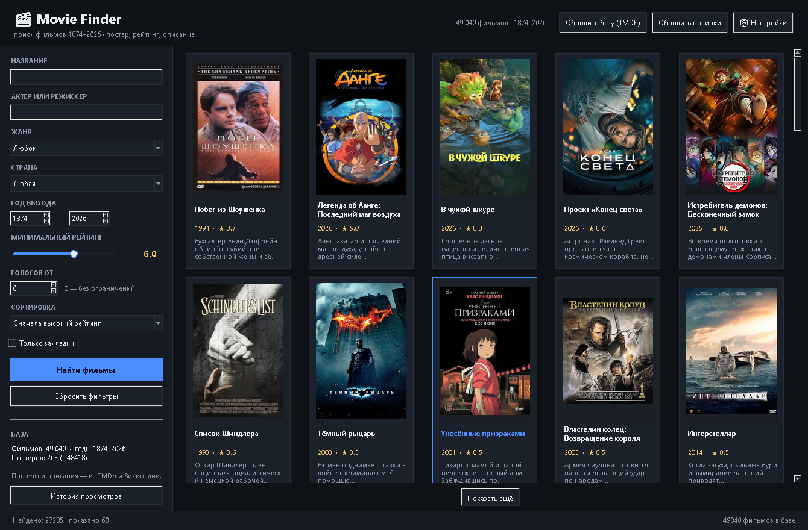
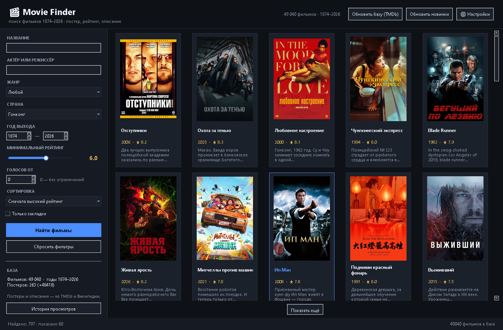
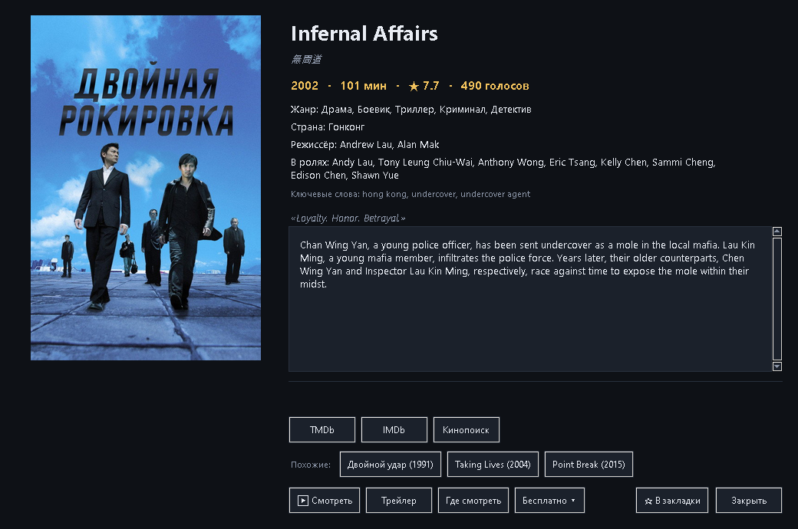
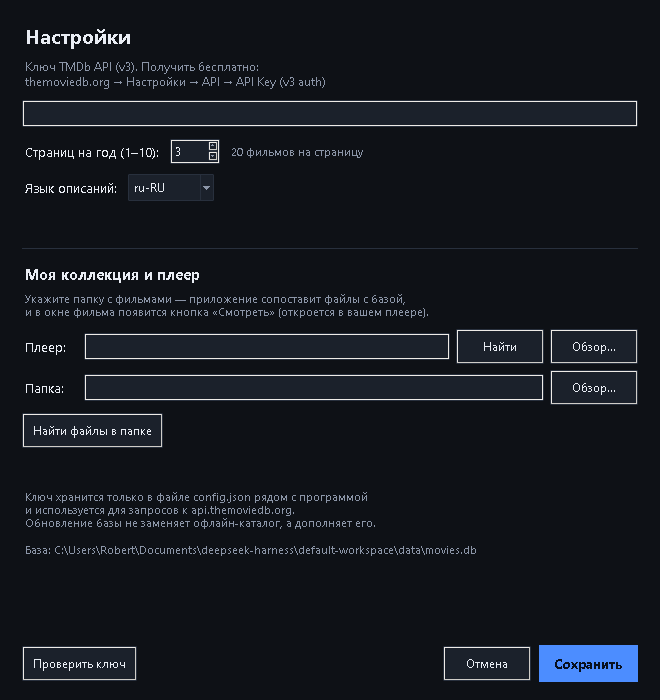
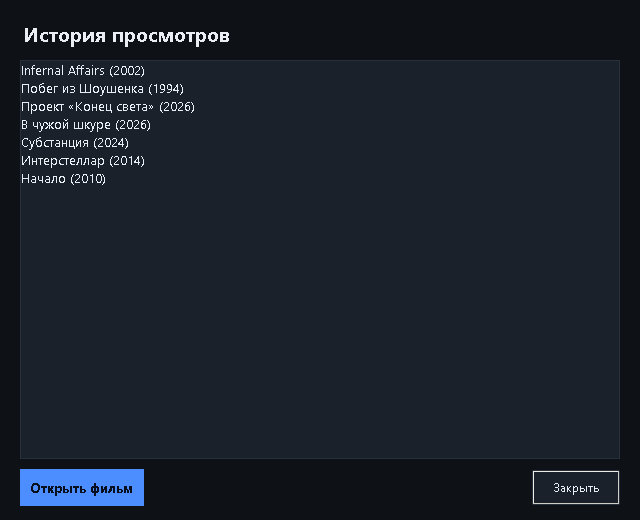
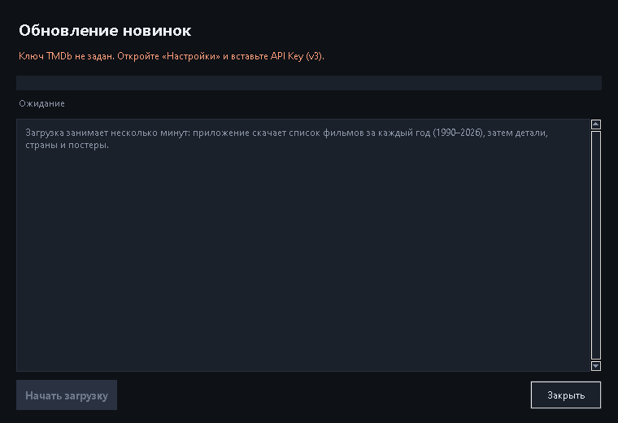

# Movie Finder — поиск фильмов с постерами и описаниями

Настольное приложение для Windows: ищет фильмы по названию, жанру, стране, году,
актёру и рейтингу, показывает постер, описание, актёров и где фильм можно
посмотреть легально. Работает без интернета — вся база лежит рядом с программой.



## Что умеет

- **Поиск и фильтры**: название, актёр или режиссёр, жанр, страна, диапазон лет
  (1874–2026), минимальный рейтинг, число голосов, сортировка (по рейтингу,
  новизне, популярности, названию).
- **Карточки**: постер, название, год, рейтинг со взвешенной формулой — случайные
  «10.0 при трёх голосах» в топ не попадают.
- **Окно фильма**: постер, оригинальное название, длительность, жанры, страна,
  режиссёр, **актёры**, **ключевые слова**, **похожие фильмы**, описание.
- **Смотреть**: кнопка «Смотреть на Мосфильме» / «Смотреть в архиве» открывает
  официальную страницу с плеером; локальные файлы запускаются в KMPlayer, VLC,
  PotPlayer, MPC-HC или mpv (плеер определяется автоматически).
- **Где смотреть**: площадки онлайн-показа из TMDb (данные JustWatch) показываются
  сразу при открытии карточки; отдельная кнопка открывает JustWatch.
- **Бесплатно**: меню с поиском по легальным бесплатным каталогам — Смотрим,
  Мосфильм, RuTube, VK Видео, Культура.РФ, Internet Archive, YouTube.
- **Закладки и история**: отметить фильм, отфильтровать «Только закладки»,
  посмотреть последние открытые фильмы.
- **Обновление базы**: полная загрузка из TMDb или кнопка «Обновить новинки»
  (последние годы + площадки показа).
- **Новые режимы** в исходном коде `source`: слепой выбор с раскрытием фильма
  только после выбора; челленджи по десятилетиям, странам, жанрам и числу
  просмотренных фильмов; локальная фильмография актёров и режиссёров со статусами;
  франшизный маршрут только по подтверждённому TMDb порядку; похожий, но менее
  известный «двойник» с объяснением совпадений и отличий; годовой отчёт по
  локальной истории и оценкам; режим «Мне всё равно» с лимитом длительности,
  исключениями и разнообразной выдачей.
- Фильмография, челленджи, двойники, отчёты и свободный подбор работают по
  локальному каталогу. Франшиза проверяется через TMDb по запросу пользователя.

> **Важно:** `Movie Finder.exe` в корне — ранее собранная версия и не содержит
> новых режимов. Актуальная сборка с каталогом собрана отдельно:
> `source\dist-safe-20261105-discovery-catalog\Movie Finder\Movie Finder.exe`.
> Она включает копию базы из предыдущей сборки (49 040 фильмов) и 1 188 постеров;
> пользовательский `config.json` не копировался. Чистая сборка без каталога —
> в `source\dist-safe-20261105-discovery\Movie Finder\`.
> Для запуска исходников с корневой пользовательской базой используйте
> `source\run.bat`.




## База

| Показатель | Значение |
|---|---|
| Фильмов | **49 040** |
| Годы | 1874–2026 |
| Актёров (записей) | 347 088 у 43 018 фильмов |
| Ключевых слов | 156 598 |
| Ссылок на легальный просмотр | 1 486 (Мосфильм 905, Internet Archive 581) |
| Фильмов с площадками онлайн | 810 |
| Объём базы | 70 МБ + кэш постеров |

Покрытие по странам: США, Великобритания, Франция, Германия, Италия, СССР/Россия,
Индия, **Япония 3 195**, **Гонконг 1 119**, Корея 523, Китай 498, Тайвань 156.



## Источники и легальность

- **TMDb API** — описания, постеры, страны, площадки показа (нужен бесплатный ключ
  v3; ключ хранится в `config.json` рядом с программой).
- **Kaggle «The Movies Dataset»** (выгрузка TMDb) — 43 тысячи фильмов, актёры,
  ключевые слова. Требует атрибуции TMDb, некоммерческое использование.
- **Мосфильм** — 905 ссылок на официальные страницы фильмов с плеером студии.
- **Internet Archive** — 581 фильм в общественном достоянии (США: до 1930 года).
- Пиратских источников нет: приложение не ищет раздачи и не встраивает трекеры.

## Структура

```
E:\Movie Finder\
├── Movie Finder.exe          программа (Python не нужен)
├── _internal\                библиотеки
├── data\
│   ├── movies.db             база SQLite
│   ├── posters\              кэш постеров
│   └── app.ico
├── config.json               ключ TMDb и настройки
├── README.md                 инструкция
├── ОПИСАНИЕ.md               этот файл
├── screenshots\              7 скриншотов
└── source\                   актуальный исходный код и тесты
    ├── main.py
    ├── movie_search\
    │   ├── ui.py, database.py, franchises.py
    │   ├── discovery_modes.py
    │   ├── discovery_ui.py
    │   └── другие модули поиска, данных и TMDb
    └── tools\                тесты и утилиты разработки
```

## Быстрый запуск

1. Скопировать папку `Movie Finder` на любой диск.
2. `Movie Finder.exe` запускает старую сборку без новых режимов.
   Новый EXE с базой и постерами лежит в
   `source\dist-safe-20261105-discovery-catalog\Movie Finder\`.
   В нём 49 040 фильмов и 1 188 постеров.
   Чтобы открыть актуальный код с корневой базой, запустить `source\run.bat`
   либо выполнить `cd /d "E:\Movie Finder\source"` и `python main.py`.
3. Исходники в папке `source` используют корневые `data\movies.db`, `data\posters`
   и `config.json`, если рядом есть корневой `Movie Finder.exe`.
4. Без ключа TMDb всё работает, кроме загрузки новинок и онлайн-площадок;
   ключ вставляется в «Настройки».

## Инструменты (из `source`)

```bat
python tools/import_dataset.py kaggle-tmdb movies_metadata.csv --credits credits.csv --keywords keywords.csv
python tools/sync_countries.py --countries "JP|HK" --from-year 1990 --pages 6
python tools/build_watch_index.py --via-api --add-missing      :: Мосфильм
python tools/build_watch_index.py --source archive             :: общественное достояние
python tools/update_providers.py --from-year 2020              :: площадки показа
python tools/fix_posters.py --limit 3000                       :: починка битых постеров
python tools/build_exe.py                                      :: сборка exe
python tools/verify.py && python tools/selftest.py             :: проверки
```

## Проверки

`--selftest` (в exe), `tools/verify.py`, `tools/selftest.py` — база, фильтры,
отрисовка карточек, диалоги, запись в базу. Сборка проверяет синтаксис всех
модулей до упаковки.




